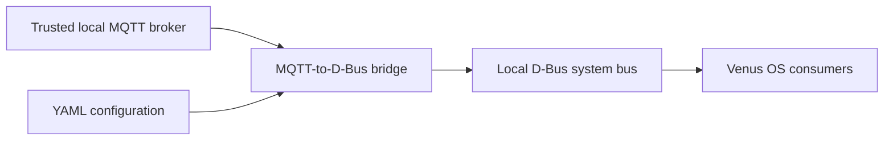

# Venus OS Integration Patterns

[](https://www.bestpractices.dev/en/projects/15558)

[](docs/fuzzing.md)

## Native GX versus companion-host examples

These patterns are examples, not certified device installers. Venus OS on Cerbo
GX or Raspberry Pi uses daemontools (`svc`, `svstat`), not systemd. Keep native
runtime/configuration under `/data`, recreate `/service` links from `/data/rc.local`,
and bound logs with `multilog` under `/var/log`. Prepare offline dependencies
matching the firmware's Python ABI/CPU; retain firmware-provided D-Bus/GLib
bindings with a virtualenv using `--system-site-packages`.

Docker/Compose examples target a separate Linux host with suitable D-Bus access.
They do not imply Docker support on a stock Venus OS image. A host reaching only
the Cerbo over TCP should use the built-in MQTT gateway; a mounted D-Bus socket
is local to the container host. Measure signal rates, memory and disconnected
broker behavior before deploying a new bridge to a GX.


A runnable MQTT-to-D-Bus example and design notes for common Victron Venus OS integrations. Review the implementation status and deployment boundaries before adapting an example.

<!-- ci-release-process:start -->
## CI and deployment

See [CI and release operations](docs/release-workflow.md) for required checks and local commands. This repository publishes versioned source archives through beta and RC channels under the [release strategy](RELEASING.md). Public RCs also run the offline [fuzzing campaigns](docs/fuzzing.md).
<!-- ci-release-process:end -->

## Quick Start

```bash
# Clone this repo
git clone https://github.com/victron-venus/venus-os-integration-patterns.git

# Navigate to a pattern
cd venus-os-integration-patterns/patterns/mqtt-to-dbus

# Review the README, then start with docker-compose
docker compose up -d
```

## Patterns

- [mqtt-to-dbus](patterns/mqtt-to-dbus/): runnable Python bridge with configuration, unit tests and a native container build.
- [dbus-to-mqtt](patterns/dbus-to-mqtt/): documentation example for publishing D-Bus updates to MQTT.
- [http-api-wrapper](patterns/http-api-wrapper/): documentation example of an HTTP interface around D-Bus.

Scheduled control and Home Assistant automation are possible extensions; this
repository does not yet ship those implementations.

## Architecture Overview



## Requirements

- **Venus OS** (Cerbo GX, Raspberry Pi with Venus OS, or Venus OS Docker)
- **MQTT Broker** (Mosquitto, EMQX, or cloud broker)
- **Python 3.10+** for Python patterns
- **Docker** (optional, for containerized deployment)

## Contributing

1. Fork the repository
2. Create a new pattern directory under `patterns/`
3. Include: `README.md`, working code, `docker-compose.yml`, `tests/`
4. Document its implementation status in the patterns list above
5. Submit a PR

## License

MIT License — see [LICENSE](LICENSE) for details.

## Related Projects

- [venus-os-ci-toolkit](https://github.com/victron-venus/venus-os-ci-toolkit) — Reusable CI/CD workflows
- [dbus-mqtt-battery](https://github.com/victron-venus/dbus-mqtt-battery) — Production JBD BMS MQTT↔D-Bus bridge
- [dbus-tasmota-pv](https://github.com/victron-venus/dbus-tasmota-pv) — Production Tasmota PV inverter D-Bus bridge
- [inverter-control](https://github.com/victron-venus/inverter-control) — Grid-zero feed-in control

## Contributing and security

See [CONTRIBUTING.md](CONTRIBUTING.md) for reports, development checks and pull requests,
[SECURITY.md](SECURITY.md) for private vulnerability reporting and deployment trust boundaries,
and the [OpenSSF evidence index](docs/openssf-evidence.md) for assessment references and remaining verification.

See [governance](GOVERNANCE.md), [community conduct](CODE_OF_CONDUCT.md) and
[the architecture, assurance scope and roadmap](docs/project-assurance.md).
The live OpenSSF assessment reports the achieved level and remaining criteria.
